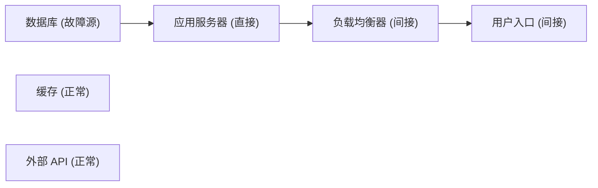

# 浏览器端功能验收清单（BROWSER ACCEPTANCE CHECKLIST）

> 项目：云镜推演（CloudMirror Deduction）
> 对应代码版本：`fefaebd`（feat: add explicit redundancy modeling）
> 文档性质：**验收准备文档**，供人工在浏览器中执行后填写结果。

---

## 一、说明

### 1.1 目的

在真实浏览器中逐项验证云镜推演前端已实现的功能，确认页面上展示的数据来自后端 API，
并记录实际结果。

### 1.2 执行状态声明（重要）

- 本清单**尚未在浏览器中人工执行**。所有用例的「实际结果」「是否通过」两列当前值均为
  **未测试**，需由验收人员实际操作后填写。
- 本清单中「预期结果」为**基于当前代码的预期**，不是已验证的结论。
- 未执行的项目一律标记为「未测试」，不得填写为「通过」。

### 1.3 不在本清单范围内

- 后端单元测试（由 `pytest` 独立执行）。
- 性能、并发、安全测试。
- 真实云资源的切流 / 容量 / 网络 / 数据同步验证（当前平台不执行真实操作）。

### 1.4 需要人工验收的原因

自动化脚本只能验证 HTTP 接口行为，无法验证：
交互手感、拖拽与连线、画布高亮配色、徽标与图例、加载与错误提示、
重复点击、布局错位遮挡、浏览器控制台报错等**纯前端表现**。

---

## 二、环境准备

### 2.1 启动后端

```bash
cd backend
.venv\Scripts\python.exe -m uvicorn app.main:app --reload      # Windows
# source .venv/bin/activate && uvicorn app.main:app --reload   # Linux/macOS
```

- 健康检查：`http://127.0.0.1:8000/api/health`
- 接口文档：`http://127.0.0.1:8000/docs`

### 2.2 启动前端（另开终端）

```bash
cd frontend
npm run dev
```

- 访问：`http://127.0.0.1:5173`

### 2.3 前置要求

- 浏览器建议 Chrome / Edge 最新版，缩放 100%，打开 F12（Console + Network）。
- 顶部导航顺序：**首页 / 系统拓扑 / 故障模拟 / 恢复策略 / 历史记录**。
- 若本地存在旧版 `backend/cloudmirror.db`，建议删除后重启后端重新建表
  （本版本恢复策略新增了 failover 字段；`create_all` 不会改动已存在的表结构）。

---

## 三、测试用例

填写约定：每条用例含 **操作步骤 / 预期结果 / 实际结果 / 是否通过**。
实际结果与是否通过初始为 **未测试**。

### 3.1 拓扑管理

#### TC-TOPO-01 创建业务拓扑

**操作步骤**
1. 顶部导航点击「系统拓扑」，点击右上角「新建拓扑」。
2. 在弹窗「新建拓扑」中填写「拓扑名称」（如 `浏览器验收拓扑`）与可选「描述」。
3. 点击弹窗底部「创建」。

**预期结果**
- 提示「拓扑创建成功」，弹窗关闭，自动跳转到 `/topology/{id}` 编辑页。
- 列表页中新增该拓扑，节点数 / 依赖数初始为 0。

**实际结果**：未测试
**是否通过**：未测试

---

#### TC-TOPO-02 添加不同类型节点

**操作步骤**
1. 进入拓扑编辑页，在右侧「添加节点」区域依次点击：
   `用户入口`、`负载均衡器`、`应用服务器`、`数据库`、`缓存`、`消息队列`、`外部 API`。

**预期结果**
- 每点击一次画布新增一个对应类型节点，共 7 个。
- 节点卡片显示名称、类型、状态，无重复报错。

**实际结果**：未测试
**是否通过**：未测试

---

#### TC-TOPO-03 拖动节点并保存位置

**操作步骤**
1. 拖动任意节点到新位置并松开。
2. 点击顶部「保存布局」。
3. 再次拖动另一个节点，再点「保存布局」。

**预期结果**
- 拖动松手后提示「节点位置已保存」。
- 点击「保存布局」：无变化时提示「布局未发生变化」；有变化时提示「已保存 N 个节点的位置」。

**实际结果**：未测试
**是否通过**：未测试

---

#### TC-TOPO-04 创建节点之间的依赖关系

**操作步骤**
1. 从节点**底部**连接点拖动到目标节点**顶部**连接点，创建依赖连线。
2. 依次连线：`用户入口 → 负载均衡器 → 应用服务器 → 数据库`。
3. 点击其中一条连线。

**预期结果**
- 连线为**实线箭头**，箭头方向即依赖方向（A → B 表示 A 依赖 B）。
- 右侧检查器显示 `{源} → {目标}（左侧节点依赖右侧节点）`，可填写描述。
- 拒绝自依赖（连到自身时给出错误提示）。

**实际结果**：未测试
**是否通过**：未测试

---

#### TC-TOPO-05 刷新页面确认拓扑数据仍然存在

**操作步骤**
1. 完成节点与依赖后按 F5 刷新。
2. 返回「系统拓扑」列表查看节点数 / 依赖数。

**预期结果**
- 刷新后节点、依赖、位置与刷新前一致（数据来自后端持久化）。
- 列表中的节点数 / 依赖数与实际一致。

**实际结果**：未测试
**是否通过**：未测试

---

#### TC-TOPO-06 修改节点属性

**操作步骤**
1. 选中一个节点，在右侧检查器修改「名称」「类型」「状态」（正常 / 故障 / 降级）「描述」。
2. 点击「保存节点」。

**预期结果**
- 保存成功，画布节点显示更新后的名称 / 类型 / 状态。
- 刷新后修改仍然生效。

**实际结果**：未测试
**是否通过**：未测试

---

#### TC-TOPO-07 删除节点并检查相关依赖边

**操作步骤**
1. 选中一个**已被其他节点依赖**的节点，点击「删除节点」。
2. 在确认框「确认删除节点「{name}」？与其相关的依赖关系将一并删除。」中确认。
3. 观察画布与依赖数。

**预期结果**
- 该节点消失，与其相连的依赖边一并消失（不残留悬空边）。
- 若该节点属于某个冗余组，冗余组由后端自动清理，前端重新拉取后不再显示该成员。
- 无报错，依赖数同步减少。

**实际结果**：未测试
**是否通过**：未测试

---

### 3.2 冗余关系管理

> 前提：拓扑中至少 2 个节点。冗余关系与依赖边相互独立。

#### TC-RED-01 创建主备冗余组

**操作步骤**
1. 编辑页右侧「冗余关系」区域点击「新建冗余组」。
2. 填写「名称」（如 `主库主备组`），「冗余模式」选择「主备模式」。

**预期结果**
- 弹窗打开，出现「主节点」「备用节点（可多选）」字段。

**实际结果**：未测试
**是否通过**：未测试

---

#### TC-RED-02 指定主节点

**操作步骤**
1. 在「主节点」下拉中选择一个节点（如 `数据库`）。

**预期结果**
- 主节点被正确选中并显示。

**实际结果**：未测试
**是否通过**：未测试

---

#### TC-RED-03 添加备用节点并设置优先级

**操作步骤**
1. 在「备用节点（可多选）」中勾选两个节点（如 `备数据库`、`备数据库二`）。
2. 在「备用优先级（数值越小越优先）」列表中分别填 `1`、`2`，点击「保存」。

**预期结果**
- 两个备用节点被选中，优先级列表出现两行。
- 保存成功，无报错。

**实际结果**：未测试
**是否通过**：未测试

---

#### TC-RED-04 检查拓扑图中是否出现紫色虚线关系

**操作步骤**
1. 保存冗余组后观察画布中节点之间。

**预期结果**
- 主节点与备用节点之间出现**紫色虚线**（带流动动画），与普通灰色实线箭头明显区分。
- 紫色虚线不可被选中（不会误当成依赖边）。

**实际结果**：未测试
**是否通过**：未测试

---

#### TC-RED-05 检查节点是否显示冗余标识

**操作步骤**
1. 查看参与冗余组的节点卡片与画布下方图例。

**预期结果**
- 主节点显示「主节点」徽标，备用节点显示「备用节点」徽标，并显示冗余组名称。
- 图例包含：普通依赖关系 / 主备关系 / 主节点 / 备用节点。

**实际结果**：未测试
**是否通过**：未测试

---

#### TC-RED-06 修改冗余关系并保存

**操作步骤**
1. 在「冗余关系」列表点击「编辑」，修改名称或备用节点 / 优先级后「保存」。

**预期结果**
- 弹窗标题为「编辑冗余组」，回显原有配置。
- 保存后列表与画布同步更新。

**实际结果**：未测试
**是否通过**：未测试

---

#### TC-RED-07 刷新页面确认数据持久化

**操作步骤**
1. 按 F5 刷新编辑页。

**预期结果**
- 冗余组列表、紫色虚线、节点徽标均从后端重新加载并完整显示。

**实际结果**：未测试
**是否通过**：未测试

---

#### TC-RED-08 删除冗余组并检查页面同步

**操作步骤**
1. 点击该组「删除」，在确认框「确认删除冗余组「{name}」？删除后 failover 将不再认为存在该备用节点。」中确认。
2. 观察拓扑编辑页；再进入「恢复策略」页，点「刷新」→「生成策略对比」。

**预期结果**
- 拓扑页：冗余组从列表消失，紫色虚线与节点徽标消失。
- 恢复策略页：由于已无显式冗余关系，failover 变为「不适用」，并给出「未找到可用的显式备用节点…」原因。
- 说明两页面读取的是同一份后端数据。

**实际结果**：未测试
**是否通过**：未测试

---

### 3.3 故障注入

#### TC-FAULT-01 选择一个业务拓扑

**操作步骤**
1. 顶部导航点击「故障模拟」，在「目标拓扑」下拉选择拓扑。

**预期结果**
- 下拉选项格式为 `{拓扑名}（{节点数} 节点 / {依赖数} 依赖）`。
- 选择后画布加载该拓扑的节点与依赖。

**实际结果**：未测试
**是否通过**：未测试

---

#### TC-FAULT-02 选择一个节点

**操作步骤**
1. 在右侧「注入故障」表单的「故障节点」下拉选择一个节点。

**预期结果**
- 下拉选项格式为 `{节点名}（{类型}）`，可正常选中。

**实际结果**：未测试
**是否通过**：未测试

---

#### TC-FAULT-03 注入节点故障

**操作步骤**
1. 「故障类型」选择「节点宕机」，「严重程度」选择（如「严重」）。
2. 「故障描述」填可选说明，点击红色「注入故障」。

**预期结果**
- 出现成功提示，右侧「故障事件（激活 X / 共 Y）」新增一条记录。
- 记录显示节点名、故障类型、严重程度徽标、状态徽标。

**实际结果**：未测试
**是否通过**：未测试

---

#### TC-FAULT-04 检查故障状态是否正确显示

**操作步骤**
1. 观察右侧故障事件列表与激活计数。

**预期结果**
- 新注入故障状态显示为「激活」，激活计数 +1。
- 同一节点重复注入同类激活故障时按后端规则合理处理，不产生异常。

**实际结果**：未测试
**是否通过**：未测试

---

#### TC-FAULT-05 检查故障记录是否保存

**操作步骤**
1. 注入故障后按 F5 刷新页面。

**预期结果**
- 刷新后故障事件仍在列表中，状态不变（后端持久化）。

**实际结果**：未测试
**是否通过**：未测试

---

#### TC-FAULT-06 执行故障恢复操作

**操作步骤**
1. 在激活故障记录上点击「恢复」。

**预期结果**
- 提示「故障已恢复」，该记录状态变为「已恢复」，激活计数 -1。
- 记录**不被删除**，仍保留在列表中。

**实际结果**：未测试
**是否通过**：未测试

---

### 3.4 故障传播分析

> 约定：`source=A, target=B` 表示 **A 依赖 B**；故障沿**反方向**传播（B 故障 → A 受影响）。

#### TC-PROP-01 创建包含应用服务器、数据库、缓存等节点的拓扑

**操作步骤**
1. 在「系统拓扑」创建拓扑并添加：用户入口、负载均衡器、应用服务器、数据库、缓存。

**预期结果**
- 节点创建成功，画布正常显示。

**实际结果**：未测试
**是否通过**：未测试

---

#### TC-PROP-02 设置清晰的依赖方向

**操作步骤**
1. 创建依赖：`用户入口 → 负载均衡器`、`负载均衡器 → 应用服务器`、`应用服务器 → 数据库`。
2. 缓存不与数据库建依赖（作为无关节点）。

**预期结果**
- 三条依赖边显示为实线箭头，箭头方向为依赖方向。

**实际结果**：未测试
**是否通过**：未测试

---

#### TC-PROP-03 对数据库注入故障

**操作步骤**
1. 在「故障模拟」对 `数据库` 注入 `node_down` 故障。

**预期结果**
- 注入成功，`数据库` 出现在激活故障列表中。

**实际结果**：未测试
**是否通过**：未测试

---

#### TC-PROP-04 执行传播分析

**操作步骤**
1. 点击「开始传播分析」。

**预期结果**
- 按钮出现加载状态，随后返回结果。
- 画布下方出现「分析结果」，显示分析编号与时间。

**实际结果**：未测试
**是否通过**：未测试

---

#### TC-PROP-05 检查直接影响节点、间接影响节点

**操作步骤**
1. 查看「分析结果」指标区。

**预期结果**
- 指标含：故障源 / 受影响节点 / 直接影响 / 间接影响 / 节点总数 / 影响比例。
- `数据库`=故障源；`应用服务器`=直接影响；`负载均衡器`、`用户入口`=间接影响。

**实际结果**：未测试
**是否通过**：未测试

---

#### TC-PROP-06 检查传播路径和影响层级

**操作步骤**
1. 查看「传播路径明细（N）」列表；点击一个受影响节点查看右侧「节点影响详情」。

**预期结果**
- 明细每条含「距离 N」、路径文本与等级徽标。
- 节点详情显示影响等级、传播距离、来源故障、完整传播路径。

**实际结果**：未测试
**是否通过**：未测试

---

#### TC-PROP-07 检查故障节点和受影响节点的高亮效果

**操作步骤**
1. 观察画布节点配色，并查看提示文字中的颜色说明。

**预期结果**
- 故障源=**红色**，直接影响=**橙色**，间接影响=**黄色**；传播路径上的连线高亮并可动画。
- 节点上显示影响等级与「距离 N」。

**实际结果**：未测试
**是否通过**：未测试

---

#### TC-PROP-08 检查无关节点是否被错误标记

**操作步骤**
1. 观察 `缓存`（或 `外部 API`）节点；点击它查看详情。

**预期结果**
- 无关节点保持原样，不被高亮、不计入受影响节点。
- 点击后提示「该节点未受当前分析影响（正常节点）。」。

**实际结果**：未测试
**是否通过**：未测试

---

#### TC-PROP-09 恢复故障后重新分析

**操作步骤**
1. 恢复 `数据库` 的故障，再次点击「开始传播分析」。

**预期结果**
- 恢复后的节点不再作为激活故障源；若无其余激活故障，返回空影响结果（不报错），
  提示没有产生传播路径。
- 旧的历史记录仍可查看（见 TC-HIST）。

**实际结果**：未测试
**是否通过**：未测试

---

### 3.5 恢复策略推荐

> 页面：「恢复策略」。页面声明「恢复时间与成本均为模拟估算值」。

#### TC-REC-01 对存在显式主备冗余关系的主节点注入故障

**操作步骤**
1. 为 `数据库` 建主备组（主 `数据库`，备用 `备数据库` P1）。
2. 对 `数据库` 注入故障，「运行传播分析」→「生成策略对比」。

**预期结果**
- 分析结果与策略对比正常生成，failover 出现在策略列表中。

**实际结果**：未测试
**是否通过**：未测试

---

#### TC-REC-02 查看 Failover 策略是否能够识别备用节点

**操作步骤**
1. 展开 failover 策略的「显式冗余判定」区域。

**预期结果**
- 显示冗余组「{name}」#id、选中备用节点，以及选择理由。
- 「备用节点候选（按 priority 升序，数值越小越优先）」列出候选。

**实际结果**：未测试
**是否通过**：未测试

---

#### TC-REC-03 检查备用节点优先级是否生效

**操作步骤**
1. 主备组设置两个备用：P1（`备数据库`）、P2（`备数据库二`）。
2. 生成策略对比，查看被选中的备用节点。

**预期结果**
- 默认选中优先级最高的**可用**备用节点（P1），其余列为备选，不随机选择。

**实际结果**：未测试
**是否通过**：未测试

---

#### TC-REC-04 检查备用节点故障 / 受影响 / 类型不兼容是否被排除

**操作步骤**
1. 分别构造以下场景并对比（每次重新分析与生成策略）：
   - 给备用节点注入故障；
   - 让备用节点位于传播影响范围内；
   - 将备用节点改为主节点不同类型的节点。
2. 查看「前置条件检查」与「不适用原因」。

**预期结果**
- 备用节点自身故障时不被选中；对应检查项「备用节点是否正常 / 备用节点是否存在激活故障」为 ✕。
- 备用节点受传播影响时对应检查项「备用节点是否受到传播影响」为 ✕。
- 类型不兼容时对应检查项「是否满足节点类型要求」为 ✕。
- 无可用备用时 failover 变为「不适用」。

**实际结果**：未测试
**是否通过**：未测试

---

#### TC-REC-05 检查没有配置冗余组时的提示

**操作步骤**
1. 使用一个**没有**冗余组的拓扑，对某节点注入故障并分析，生成策略对比。

**预期结果**
- failover 显示「不适用」。
- 「不适用原因」以「未找到可用的显式备用节点，无法执行切换：」开头，并逐节点说明
  （如「节点「主数据库」：没有显式冗余关系」）。
- 系统**不会**因「存在同类型节点」而推断备用节点。

**实际结果**：未测试
**是否通过**：未测试

---

#### TC-REC-06 检查恢复策略的适用条件、排除原因和选择依据

**操作步骤**
1. 展开 failover 的「前置条件检查」与顶部「推荐结论」。

**预期结果**
- 前置条件逐项显示 ✓/✕ 与说明，包含：
  是否存在显式主备关系 / 冗余模式是否支持切换 / 故障节点是否为主节点 /
  冗余组是否存在备用节点 / 备用节点是否正常 / 备用节点是否存在激活故障 /
  备用节点是否受到传播影响 / 是否满足节点类型要求 / 备用节点是否存在故障依赖 /
  备用节点优先级是否明确。
- 「推荐结论」给出推荐策略与推荐理由。

**实际结果**：未测试
**是否通过**：未测试

---

#### TC-REC-07 检查页面是否明确提示「仅模拟，不执行真实恢复」

**操作步骤**
1. 查看页面副标题、推荐结论下方提示、failover 选择理由、策略卡片的优势 / 劣势。

**预期结果**
- 页面明确说明恢复时间与成本为「模拟估算值 / 不是真实生产环境测量值」。
- failover 选择理由包含「不代表真实生产环境已验证容量、网络连通性、数据同步与配置一致性」。
- 不出现「已执行切换」等误导性表达。

**实际结果**：未测试
**是否通过**：未测试

---

#### TC-REC-08 检查策略耗时等数值是否明确标注为模拟估算

**操作步骤**
1. 查看对比矩阵的「预计恢复时间」与页面底部「评分规则」。

**预期结果**
- 时间等数值有「模拟估算」标注，并展示权重（恢复时间 / 影响范围 / 资源成本 / 操作风险 /
  业务恢复程度）与参考恢复时间。

**实际结果**：未测试
**是否通过**：未测试

---

### 3.6 历史记录

#### TC-HIST-01 执行一次完整故障注入和传播分析

**操作步骤**
1. 对某拓扑注入故障并执行传播分析（参见 3.4）。

**预期结果**
- 生成一条分析记录，可在「历史记录」中查到。

**实际结果**：未测试
**是否通过**：未测试

---

#### TC-HIST-02 查看历史记录列表

**操作步骤**
1. 进入「历史记录」，选择一个拓扑。

**预期结果**
- 列表按时间倒序，含：拓扑名称、分析时间、故障源数、直接影响、间接影响、总影响、影响比例。
- 分页控件显示的总数来自后端接口。

**实际结果**：未测试
**是否通过**：未测试

---

#### TC-HIST-03 打开一条历史记录

**操作步骤**
1. 点击某条记录的「查看详情」。

**预期结果**
- 弹窗展示当时的完整快照：指标、故障源、受影响节点（等级 / 距离 / 路径）。

**实际结果**：未测试
**是否通过**：未测试

---

#### TC-HIST-04 刷新页面检查历史数据是否保留

**操作步骤**
1. 按 F5 刷新「历史记录」页。

**预期结果**
- 历史列表与分页数据保持不变（后端持久化）。

**实际结果**：未测试
**是否通过**：未测试

---

#### TC-HIST-05 检查历史数据与对应拓扑、故障事件是否匹配

**操作步骤**
1. 回看某条历史记录详情；对照该拓扑当时注入的故障。

**预期结果**
- 详情中的故障源、受影响节点与该次分析一致；即使故障已恢复或节点已删除，仍可完整查看。

**实际结果**：未测试
**是否通过**：未测试

---

### 3.7 异常和稳定性

#### TC-EXC-01 后端关闭时访问前端，检查错误提示

**操作步骤**
1. 停止后端（Ctrl+C）。
2. 打开「首页」点「重新检测」；再进入「系统拓扑」「故障模拟」「恢复策略」「历史记录」触发加载。

**预期结果**
- 首页显示「后端未连接」并给出错误信息与启动提示，页面不崩溃。
- 其他页面显示错误 `el-alert`，提示「请确认后端服务已启动，然后点击「刷新」重试。」，不白屏。

**实际结果**：未测试
**是否通过**：未测试

---

#### TC-EXC-02 检查加载状态

**操作步骤**
1. 点击会发起请求的按钮（「开始传播分析」「生成策略对比」「创建」「注入故障」）。

**预期结果**
- 按钮 / 画布出现 loading 状态，请求结束后消失。

**实际结果**：未测试
**是否通过**：未测试

---

#### TC-EXC-03 连续点击提交按钮，检查是否出现重复提交

**操作步骤**
1. 打开 Network 录制，快速连续点击「注入故障」「创建」「生成策略对比」等。

**预期结果**
- 提交按钮在请求进行中进入 loading 并被禁用，同一时间窗口内不重复发出相同请求。
- 不出现重复创建的拓扑 / 节点 / 故障。
- 说明：当前实现仅有「进行中禁用」这一层防护，未实现幂等键；跨请求窗口的极快点击理论上
  仍可能重复提交，请重点观察并记录。

**实际结果**：未测试
**是否通过**：未测试

---

#### TC-EXC-04 刷新页面检查数据是否持久化

**操作步骤**
1. 在各页面进行增删改后按 F5。

**预期结果**
- 拓扑、节点、依赖、冗余组、故障、分析结果均从后端恢复，不丢失。
- 未保存的临时表单输入丢失属预期。

**实际结果**：未测试
**是否通过**：未测试

---

#### TC-EXC-05 检查浏览器控制台是否存在明显错误

**操作步骤**
1. 打开 Console，按上述用例操作一遍。

**预期结果**
- 除「后端未连接」场景下的预期网络错误外，无未捕获异常、无 Vue 错误级别以上报错。

**实际结果**：未测试
**是否通过**：未测试

---

#### TC-EXC-06 检查 Network 是否存在异常的 404、500 请求

**操作步骤**
1. 打开 Network，正常操作全部功能，过滤 404 / 500。

**预期结果**
- 正常流程无 404 / 500。
- 例外：从未分析过的拓扑调用 `analysis/latest` 时后端可能返回 404（前端静默忽略，属预期）。
- 若出现 500，重点检查旧 `cloudmirror.db` 缺列或请求体字段不匹配。

**实际结果**：未测试
**是否通过**：未测试

---

#### TC-EXC-07 检查页面是否存在明显错位、遮挡、无法点击等问题

**操作步骤**
1. 调整浏览器窗口大小（桌面常见宽度），逐页观察。

**预期结果**
- 无元素重叠遮挡、按钮可点击、无文本溢出、无横向滚动条异常。

**实际结果**：未测试
**是否通过**：未测试

---

## 四、重点检查问题（跨用例）

以下 6 项为本次重点，前文相关用例已覆盖，此处单独列出便于聚焦。

| 编号 | 重点问题 | 覆盖用例 | 预期表现 | 实际结果 | 是否通过 |
| --- | --- | --- | --- | --- | --- |
| TC-FOCUS-01 | 新增冗余关系后，拓扑页与恢复策略页是否使用同一份后端数据 | TC-RED-08、TC-REC-01~05 | 后端为唯一数据源，两侧一致 | 未测试 | 未测试 |
| TC-FOCUS-02 | 删除节点后，冗余组、依赖边是否存在残留数据 | TC-TOPO-07 | 依赖边级联删除；冗余组失效则一并清理，无残留 | 未测试 | 未测试 |
| TC-FOCUS-03 | 故障恢复后，旧传播分析结果是否被当作当前结果 | TC-PROP-09、TC-HIST | **当前为快照语义**：`analysis/latest` 返回最近一次存储的分析，恢复故障后不会自动失效，需重新分析才更新；见 `KNOWN_LIMITATIONS.md` L-11 | 未测试 | 未测试 |
| TC-FOCUS-04 | 刷新后节点位置、依赖关系、冗余关系是否正确恢复 | TC-TOPO-03/05、TC-RED-07 | 全部从后端恢复 | 未测试 | 未测试 |
| TC-FOCUS-05 | 恢复策略是否严格依据显式冗余关系，而非按节点类型猜测 | TC-REC-05 | 无显式冗余即不适用，绝不按类型推断 | 未测试 | 未测试 |
| TC-FOCUS-06 | 模拟恢复估算是否存在易被误认为真实测量数据的表达 | TC-REC-07/08 | 页面明确标注「模拟估算值 / 不是真实测量值」 | 未测试 | 未测试 |

---

## 五、结果汇总（人工填写）

| 分类 | 用例数 | 通过 | 不通过 | 未测试 |
| --- | --- | --- | --- | --- |
| 拓扑管理（TC-TOPO） | 7 | | | 7 |
| 冗余关系（TC-RED） | 8 | | | 8 |
| 故障注入（TC-FAULT） | 6 | | | 6 |
| 传播分析（TC-PROP） | 9 | | | 9 |
| 恢复策略（TC-REC） | 8 | | | 8 |
| 历史记录（TC-HIST） | 5 | | | 5 |
| 异常与稳定性（TC-EXC） | 7 | | | 7 |
| 重点检查（TC-FOCUS） | 6 | | | 6 |
| **合计** | **56** | | | **56** |

---

## 附录 A：建议验收数据

- 拓扑：`浏览器验收拓扑`
- 节点：用户入口、负载均衡器、应用服务器、数据库、缓存、外部 API、备数据库、备数据库二
- 依赖（箭头为依赖方向）：用户入口 → 负载均衡器 → 应用服务器 → 数据库
- 无关节点：缓存、外部 API
- 冗余组：`主数据库主备组`（主备模式；主 `数据库`；备用 `备数据库` P1、`备数据库二` P2）
- 演示故障：`数据库` · `node_down` · `critical`



---

## 附录 B：常见问题排查

| 现象 | 可能原因 | 排查方式 |
| --- | --- | --- |
| 首页一直「后端未连接」 | 后端未启动 / 端口不对 | 访问 `/api/health`；检查 `VITE_API_BASE_URL` |
| Console 出现 CORS 报错 | 后端 CORS 未允许前端地址 | 检查后端 CORS 配置 |
| 接口 404 | API 路径拼写错误 | Network 中查看真实请求 URL |
| 接口 500，提示缺列 | 旧 `cloudmirror.db` 结构落后 | 删除该库文件后重启后端 |
| 紫色虚线不显示 | 冗余组未保存 / 节点少于 2 个 | 确认成员有效 |
| failover 始终不适用 | 未建立显式冗余组 | 当前版本需显式建组，不按类型推断 |
