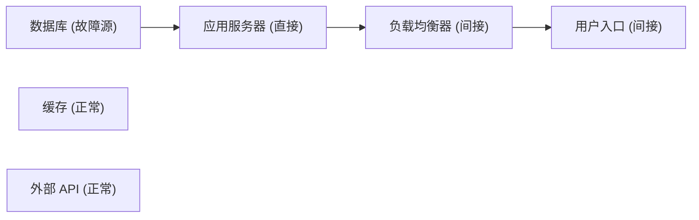

# 现场演示流程（DEMO SCRIPT）

> 项目：云镜推演（CloudMirror Deduction）
> 场景：比赛答辩 / 现场演示，约 **5 分钟**
> 原则：全部操作走**真实前后端接口**，不展示静态假数据；只演示**当前已实现**的功能。

---

## 一、演示前检查清单（提前 10 分钟完成）

| 检查项 | 操作 | 期望 |
| --- | --- | --- |
| 后端已启动 | `cd backend` → `.venv\Scripts\python.exe -m uvicorn app.main:app --reload` | 出现 `Uvicorn running on http://127.0.0.1:8000` |
| 后端健康 | 浏览器打开 `http://127.0.0.1:8000/api/health` | 返回状态与版本 JSON |
| 前端已启动 | `cd frontend` → `npm run dev` | 出现 `Local: http://127.0.0.1:5173/` |
| 数据库干净 | 如有旧数据，删除 `backend/cloudmirror.db` 后重启后端 | 建表成功，无 500 |
| 演示数据就绪 | 提前建好 `电商核心链路` 拓扑与主备组（见附录） | 拓扑列表可见 |
| 浏览器准备 | Chrome / Edge，缩放 100%，关闭无关标签 | 画面完整 |
| 控制台干净 | F12 确认无红色报错 | 无未捕获异常 |

> 全流程均为本地 `127.0.0.1` 通信，不依赖外网。

---

## 二、时间轴总览

---

## 三、分步演示

### 步骤 1 ｜ 0:00 – 0:30 ｜ 首页：系统与后端连接

**操作**
1. 打开 `http://127.0.0.1:5173`，停留在「首页」。
2. 指出「后端连接状态」为「已连接」及下方接口版本、项目名称。

**讲解内容**
> 这是云镜推演首页。它不读本地假数据，而是实时调用后端 `/api/health` 展示连接状态，
> 说明界面上的每一个结论都来自真实服务。

**预期画面**
- 首页状态标签显示「已连接」，旁边 meta 显示服务状态 / 项目名称 / 英文名称 / 接口版本。

**可选加分（10 秒）**：停掉后端 → 首页显示「后端未连接」并给出启动指引 → 重启后端 → 点
「重新检测」恢复。用于证明「没有后端时不崩溃、也不假装成功」。

---

### 步骤 2 ｜ 0:30 – 1:30 ｜ 系统拓扑：搭建业务与冗余

**操作**
1. 顶部导航「系统拓扑」，进入 `电商核心链路` 编辑页。
2. 指出已有链路：用户入口 → 负载均衡器 → 应用服务器 → 数据库（**箭头方向 = 依赖方向**）。
3. 拖动一个节点，松手出现「节点位置已保存」。
4. 「新建冗余组」：主备模式，主节点 `数据库`，备用 `备数据库`（P1）、`备数据库二`（P2），保存。
5. 指出画布上的**紫色虚线**、节点「主节点 / 备用节点」徽标与下方图例。

**讲解内容**
> 我们把业务依赖和冗余关系分开建模：灰实线箭头是依赖，紫虚线是显式主备关系。
> 关键点——备用节点不是靠「同类型」猜出来的，而是显式声明的，后面 failover 只认这个。

**预期画面**
- 画布出现紫色虚线动画；节点卡片带「主节点 / 备用节点」徽标；图例含四项说明。

---

### 步骤 3 ｜ 1:30 – 2:00 ｜ 故障模拟：注入故障

**操作**
1. 导航「故障模拟」，选择 `电商核心链路`。
2. 注入故障：节点 `数据库`，类型「节点宕机」，严重程度「严重」，描述 `主库连接耗尽`，
   点击「注入故障」。
3. 展示右侧「故障事件（激活 1 / 共 1）」。

**讲解内容**
> 故障是独立的事件记录，不篡改节点本身状态。这样历史可回溯，也允许同一节点多种故障、支持恢复。

**预期画面**
- 右侧故障列表新增一条激活记录，含节点名、类型、严重程度与状态徽标。

---

### 步骤 4 ｜ 2:00 – 2:45 ｜ 传播分析：算法与可视化

**操作**
1. 点击「开始传播分析」。
2. 展示「分析结果」指标：故障源 / 直接影响 / 间接影响 / 影响比例。
3. 指出配色：红色故障源、橙色直接影响、黄色间接影响；无关节点保持原样。
4. 点击一个间接受影响节点，展示右侧「影响等级 / 传播距离 / 来源故障 / 传播路径」。
5. 展示「传播路径明细」列表。

**讲解内容**
> 传播方向不是「相邻节点」，而是沿依赖反方向逐层扩散：数据库宕机 → 应用服务器（直接）→
> 负载均衡器 → 用户入口（间接）。算法用多源 BFS 计算最短传播距离、记录完整路径，
> 能处理环路、多故障源，并对受影响节点去重。画布上的无关节点不会被误标——这证明结果是算出来的。

**预期画面**
- 节点按红 / 橙 / 黄高亮并显示「距离 N」；路径连线高亮；明细列出各条路径。

---

### 步骤 5 ｜ 2:45 – 4:00 ｜ 恢复策略：规则评分与显式冗余判定

**操作**
1. 导航「恢复策略」，确认拓扑，如无结果先点「运行传播分析」。
2. 点击「生成策略对比」。
3. 展示对比矩阵：预计恢复时间 / 估算影响节点 / 资源成本 / 操作风险 / 综合评分 / 不适用原因。
4. 展开 failover 的「显式冗余判定」：冗余组名称、选中备用节点、选择理由。
5. 展开「备用节点候选（按 priority 升序）」与「前置条件检查」（✓/✕ 与说明）。
6. 指出顶部「推荐结论」与「模拟估算」声明、底部「评分规则」权重。

**讲解内容**
> 恢复策略是可解释的加权规则，不是黑盒 AI：权重全部写在代码和页面里，可复现。
> failover 每一步都要通过前置条件校验——是否有显式主备关系、备用是否正常、是否受传播影响、
> 优先级是否明确。备用节点按优先级升序选择，绝不随机。所有时间与成本都是模拟估算值，不做夸大。

**预期画面**
- 策略矩阵与徽标（适用 / 不适用 / 推荐）；failover 展开区显示冗余组、候选与检查项；
  推荐结论含策略名、评分与理由；底部显示权重百分比。

---

### 步骤 6 ｜ 4:00 – 4:30 ｜ 对比演示：删掉冗余组，failover 立即不适用

**操作**
1. 返回「系统拓扑」，在编辑页删除 `主数据库主备组`。
2. 回到「恢复策略」，点「刷新」后重新「生成策略对比」。
3. 展示 failover 变为「不适用」，原因为「未找到可用的显式备用节点…」。

**讲解内容**
> 同一套故障、同一套算法，只因为去掉了显式冗余关系，切换方案立刻变得不适用。
> 这直接反驳了「用同类型节点冒充备用」的做法，也说明结论完全由输入拓扑和故障记录决定，可复现。

**预期画面**
- failover 徽标变为「不适用」，「不适用原因」列出逐节点说明。

---

### 步骤 7 ｜ 4:30 – 5:00 ｜ 历史记录：快照回溯

**操作**
1. 导航「历史记录」，选择 `电商核心链路`。
2. 展示列表（分析时间 / 故障源数 / 直接影响 / 间接影响 / 总影响 / 影响比例）与分页。
3. 点击「查看详情」，展示当时完整快照：故障源、受影响节点、路径。

**讲解内容**
> 每次分析都以快照形式落库，即使后来恢复了故障、删除了节点，当时的分析与结论依然可完整回溯。
> 这就是云镜推演：把故障传播与恢复决策变成可复现、可解释、可回溯的推演过程。

**预期画面**
- 历史列表按时间倒序；详情弹窗显示该次分析的指标、故障源与受影响节点。

---

## 四、收尾陈述（可选，10 秒）

> 需要强调：本平台是**虚拟推演**，只做故障传播分析与恢复策略的规则估算，
> **不会实际操作任何云资源**。目的是在动手之前，把影响范围和候选恢复方案先算清楚。

---

## 五、时间不够时的取舍

| 优先级 | 保留 | 可省略 |
| --- | --- | --- |
| 必须 | 拓扑链路、故障注入、传播分析高亮、策略推荐 | — |
| 次重要 | 步骤 6 删冗余组对比、历史详情 | 历史分页 |
| 可省略 | 后端离线演示、拖动保存位置 | 全屏轮播 |

---

## 六、常见提问与应答

| 提问 | 应答要点 |
| --- | --- |
| 传播算法是不是随机 / 演示数据？ | 不是。多源 BFS 按依赖反方向传播，结果只由拓扑与故障记录决定，可复现；页面注明无演示数据。 |
| 备用节点怎么来的？ | 只来自显式冗余组，不按同类型推断；不满足条件即 `applicable=false` 并说明原因。 |
| 评分是不是训练出来的 AI 模型？ | 不是。是可解释的固定权重加权规则，权重在代码与页面公开。 |
| 是不是真的能切流恢复生产？ | 不能。不执行真实切流，没有容量 / 网络 / 健康探测 / 数据同步校验，结果属虚拟推演与规则估算。 |
| 能处理环路吗？ | 能。算法用访问标记避免重复与死循环，测试已覆盖环路与多故障源场景。 |

---

## 附录 A：演示数据建议

- 拓扑：`电商核心链路`
- 依赖（箭头为依赖方向）：用户入口 → 负载均衡器 → 应用服务器 → 数据库
- 无关节点：缓存、外部 API
- 冗余组：`主数据库主备组`（主备模式；主 `数据库`；备用 `备数据库` P1、`备数据库二` P2）
- 演示故障：`数据库` · `node_down` · `critical`

## 附录 B：演示失败时的应急

| 情况 | 应急处理 |
| --- | --- |
| 前端页面打不开 | 确认前端终端仍在运行且显示 `Local:` 地址；必要时 `npm run dev` 重启 |
| 接口 500 | 删除 `backend/cloudmirror.db` 后重启后端，重新快速建一个最小拓扑 |
| 时间不够 | 跳到步骤 4 与步骤 5（算法与策略是核心） |
| 网络/投影异常 | 全流程为本地通信，可离线演示；提前截图作为兜底 |
