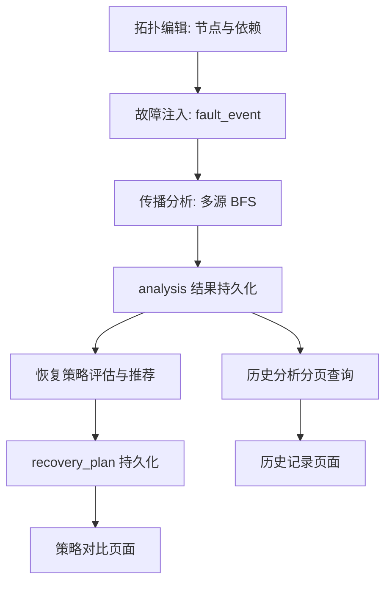

# 技术方案

本文档说明云镜推演（CloudMirror Deduction）的系统架构、数据流与**恢复策略算法设计**。
功能状态严格区分「已实现 / 当前为模拟估算 / 尚未实现」，不夸大算法效果，也不提供任何未经
实测的性能数据。

## 1. 技术栈与分层

| 层次 | 技术 |
| --- | --- |
| 后端 | Python 3.11+、FastAPI、Pydantic、SQLAlchemy 2.x、SQLite |
| 前端 | Vue 3、Vite、TypeScript、Element Plus、Vue Flow、Axios |
| 测试 | pytest（后端）、`vue-tsc` 类型检查 + Vite 生产构建（前端） |

后端采用「路由 → 服务 → 模型」三层结构：

```
app/api/*.py        仅做参数声明与依赖注入，不含业务规则
app/services/*.py   业务与算法（拓扑 / 故障 / 传播分析 / 恢复策略）
app/models/*.py     SQLAlchemy ORM 模型
app/schemas/*.py    Pydantic 请求 / 响应模型（枚举约束取值）
app/core/*.py       配置与数据库会话
```

算法均实现于独立 Service（`propagation_service.py`、`recovery_service.py`），
**不写在路由中**，便于单元测试与复用。

## 2. 数据处理流程



每一步的结果都落库，历史记录保存了故障源与节点名称的**快照**，因此故障恢复或节点删除后
仍可回看当时的分析结果。

## 3. 依赖方向与传播方向

**约定：边 `A → B` 表示「A 依赖 B」**（`source_node_id = A`、`target_node_id = B`）。

- 前端 Vue Flow 中箭头由 A 指向 B（指向被依赖方）。
- 故障传播方向与依赖方向**相反**：A 依赖 B，则 B 故障时 A 可能受影响，传播方向为 `B → A`。
- 算法构建反向邻接表 `dependents[B].append(A)`，从故障源沿 `dependents` 扩散。
- 恢复策略中「直接依赖方」同样使用该反向表（`dependents_map`），与传播算法方向保持一致。

该约定在模型、路由、服务与前端类型定义中保持一致，避免画布箭头与算法方向不一致。

## 4. 故障传播算法（已实现）

实现：`backend/app/services/propagation_service.py`。

- **多源 BFS**：所有激活故障源作为距离 0 的根同时入队，边权重为 1，首次发现即最短距离。
- **确定性**：故障源按 `fault_id` 升序、邻接按 `node_id` 升序处理，结果可复现。
- **环路安全**：以已发现集合做访问控制，环路不会死循环，也不会重复统计。
- **去重**：受影响节点以 `node_id` 为键；多源触达时保留最短距离，距离相同按确定顺序取先者。
- **等级**：距离 1 为 `direct`，距离 ≥ 2 为 `indirect`；故障源本身不计入受影响节点。
- 无激活故障时返回空结果而不报错。

## 5. 恢复策略算法设计

实现：`backend/app/services/recovery_service.py`；参数与权重：`recovery_config.py`。

### 5.1 输入与输出

**输入**

- 当前拓扑的节点列表与依赖边列表；
- 一次传播分析结果（`AnalysisResult`），其中包含故障源快照与受影响节点。

**输出**

- 三类策略（`restart_service` / `failover` / `isolate_node`）的：
  - 是否适用（`applicable`）与不适用原因（`inapplicable_reason`）；
  - 估算恢复时间、估算影响节点数、资源成本、风险等级；
  - 综合评分（0-100）；
  - 优势 / 劣势 / 前置条件条目；
- 推荐策略 ID 与推荐理由；
- 「模拟估算值」声明。

### 5.2 估算公式（模拟估算，非实测）

| 策略 | 估算恢复时间 | 估算影响节点 | 资源成本 | 风险 |
| --- | --- | --- | --- | --- |
| 服务重启 | `120 + 60 × 可重启节点数` | 可重启节点数 | 低 | 中 |
| 备用节点切换 | `60 + 30 × 故障节点数` | 故障节点数 | 高 | 低 |
| 故障节点隔离 | `30 + 15 × 故障节点数` | 故障节点数 + 直接依赖方数 | 低 | 低 / 中 |

- 「可重启节点数」= 故障类型属于 `node_down` / `service_unavailable` 的故障节点数。
- 「估算影响节点」定义为**执行该操作预计需要停机或会短暂失去服务的节点数量**。
- 「直接依赖方数」= 依赖某个故障节点的节点去重数量。

> 上述常数与系数是工程上的经验取值，仅用于策略之间的**相对比较**，
> 不代表任何真实环境的观测数据。

### 5.3 适用性规则

**服务重启（`restart_service`）**

- 适用：存在至少一个 `node_down` / `service_unavailable` 故障。
- 不适用：故障全部为网络类（`network_latency` / `network_unreachable`）——
  重启无法解决链路问题。

**备用节点切换（`failover`）**

- 项目**尚未**建立显式冗余关系模型，因此不虚构备用服务器。
- 备用节点判定采用保守代理规则：拓扑中存在另一个节点，满足
  1. 与故障节点**类型相同**；
  2. 本身不是故障源；
  3. 不在本次分析的影响节点集合内。
- 所有故障节点都必须存在这样的备用节点，`failover` 才判定为适用；
  否则返回 `applicable=false`，原因中列出缺失备用节点的具体名称。

**故障节点隔离（`isolate_node`）**

- 分析对象为 `user_entry`（用户入口）节点。
- 以下任一情况判定为**不适用且风险 = high**：
  - 某个 `user_entry` 节点自身处于故障状态；
  - 隔离后某个 `user_entry` 节点将失去其**全部**直接依赖。
- 其余情况下策略适用；当存在直接依赖方会被切断时风险为 `medium`，否则为 `low`。
- 隔离只阻断扩散，**不保证**故障节点自身恢复服务，这一点在策略描述中明确写出。

### 5.4 评分模型（可解释加权规则）

各分项归一化到 `[0, 1]` 后加权求和，再乘以 100 得到 0-100 分：

| 分项 | 权重 | 计算 |
| --- | --- | --- |
| 恢复时间 | 0.25 | `1 - min(t, 600) / 600` |
| 影响范围 | 0.20 | `1 - min(影响节点数, 总节点数) / 总节点数` |
| 资源成本 | 0.15 | 低 1.0 / 中 0.5 / 高 0.2 |
| 操作风险 | 0.20 | 低 1.0 / 中 0.6 / 高 0.2 |
| 业务恢复程度 | 0.20 | 重启 0.85 / 切换 0.95 / 隔离 0.35 |

- 权重合计 1.00；参考恢复时间 600 秒。
- 权重、系数与映射表全部在 `recovery_config.py` 中显式定义，便于审计与调整。
- **不使用随机数、不使用机器学习或大模型**，不含时间等外部状态，结果完全可复现。

### 5.5 推荐规则

1. 只在 `applicable = true` 的策略中挑选；
2. 取综合评分最高者；
3. 评分相同按固定顺序 `restart_service → failover → isolate_node` 打破平局（保证确定性）；
4. 若没有任何适用策略，`recommended_strategy_id = null`，并在理由中列出每种策略的不适用原因。

不适用策略的评分照常计算并返回，但**永远不会**成为推荐策略——避免「评分高但不可执行」。

### 5.6 边界与异常

| 场景 | 处理 |
| --- | --- |
| 拓扑不存在 | `404` |
| `analysis_id` 不存在 | `404`「分析结果不存在」 |
| `analysis_id` 属于其它拓扑 | `404`「分析结果不属于该拓扑」 |
| 该拓扑没有任何分析记录 | `404`「尚无传播分析结果」 |
| 分析结果没有激活故障源 | `400`「没有激活故障源，无法生成恢复策略」 |
| 拓扑没有节点 | 影响范围分项按空集处理，不影响其它规则 |

## 6. 数据模型与一致性

- `recovery_plan` 记录一次推荐，`recovery_strategy` 记录每种策略的评估，
  `recovery_strategy_note` 以有序子表保存优势 / 劣势 / 前置条件（不使用 JSON 大字段）。
- `recovery_plan.recommended_strategy_id` 为**软引用**（无外键）：
  若与 `recovery_strategy.plan_id` 互相建立外键会形成循环，
  SQLAlchemy 建表排序会失败，且 SQLite 不支持事后 `ALTER TABLE` 加约束。
- `recovery_plan.analysis_id` 使用 `ON DELETE SET NULL`，分析被删除时保留计划主体。
- 所有删除通过 `ON DELETE CASCADE` 或 ORM `cascade` 处理，SQLite 连接开启
  `PRAGMA foreign_keys=ON` 使外键动作真正生效。
- 建表使用 `Base.metadata.create_all()`，**幂等**，重复启动不会清空已有拓扑与历史。

## 7. 前端架构

- `src/api/*.ts`：按领域封装接口与类型（`topology` / `fault` / `analysis` / `recovery`）。
- `src/constants/*.ts`：枚举的中文标签与配色，避免在组件中散落魔法值。
- `src/views/*.vue`：页面级组件，统一通过真实 API 获取数据；加载、成功、失败均有明确反馈。
- `Recovery.vue`：以对比矩阵呈现三类策略，突出指标间的比较关系；推荐列高亮，
  不适用列淡化并展示原因；底部展示后端返回的评分权重，保证「规则可解释」。
- `History.vue`：分页调用后端接口，详情通过弹窗展示当时的完整分析快照。

## 8. 功能状态

### 已实现

- 拓扑 / 节点 / 依赖的建模与 CRUD、Vue Flow 编辑器与位置持久化。
- 故障注入、查询与恢复；故障历史保留。
- 多源 BFS 传播分析（反向传播、环路安全、去重、路径与影响等级）与结果持久化。
- 恢复策略评估、规则评分、推荐与持久化；策略对比页面。
- 推演历史分页查询、单条详情与历史记录页面。
- 后端 82 项测试、前端类型检查与生产构建。

### 当前为模拟估算

- 恢复时间、资源成本、影响节点数与推荐评分均为规则估算值。
- `failover` 的备用节点由「同类型且未受影响」推断，不是真实冗余关系。
- 不模拟负载均衡、副本切换、数据一致性、网络拓扑等真实运维细节。

### 尚未实现

- 显式冗余 / 备用节点关系建模。
- 真实执行恢复动作或对接真实云平台 API。
- 多策略组合执行、执行进度跟踪与回滚。
- 节点 / 边的高级属性（权重、容量、延迟）。
- 浏览器自动化端到端测试与部署说明。

### 后续计划

1. 引入冗余关系模型，使 `failover` 基于真实备用节点判定。
2. 引入恢复动作的执行编排（当前只输出策略）。
3. 支持策略组合与成本预算约束下的最优选择。
4. 增加端到端测试与部署文档。

## 9. 已知限制

- 传播分析假设「依赖方在依赖对象完全不可用时受影响」，不区分部分降级与冗余吸收。
- 网络类故障与进程类故障在传播上按同一套可达性规则处理，未建模带宽 / 延迟阈值。
- 历史记录保存的是分析时的快照；拓扑后续变更不会改写历史结果，这是有意设计。
