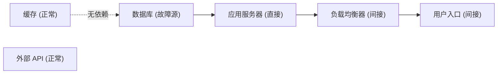

# 浏览器端功能验收测试清单

> 项目：云镜推演（CloudMirror Deduction）
> 文档版本：v1，对应提交 `fefaebd`（feat: add explicit redundancy modeling）
> 适用对象：人工验收人员 / 比赛答辩准备人员

---

## 一、文档说明

### 1. 目的

本清单用于在**真实浏览器**中逐项验证云镜推演前端已完成的功能是否能够被真实操作，
并确认前端展示的数据确实来自后端 API（而非静态假数据）。

### 2. 范围

覆盖以下 7 个部分的浏览器端操作：

1. 拓扑管理
2. 冗余关系
3. 故障注入
4. 传播分析
5. 恢复策略
6. 历史记录
7. 异常与稳定性

### 3. 不在本清单内

- 不包含后端单元测试（后端测试由 `pytest` 独立执行，见 `docs/项目说明.md`）。
- 不包含性能压测、并发压测、安全渗透测试。
- 不包含真实云平台的切流、容量、网络、数据同步验证（当前版本均为虚拟推演与规则估算）。

### 4. 执行方式声明（重要）

- 本清单的「实际结果」「是否通过」「问题记录」三列为**空**，由人工在浏览器中执行后填写。
- **本次交付没有执行浏览器端人工测试**，仅提供了测试步骤与预期结果。
- 请勿把「预期结果」当作已实际验证的结论。

---

## 二、环境准备

### 1. 启动后端

```bash
cd backend
python -m venv .venv

# Windows
.venv\Scripts\activate
# Linux / macOS
source .venv/bin/activate

pip install -r requirements.txt
uvicorn app.main:app --reload
```

- 后端地址：`http://127.0.0.1:8000`
- 接口文档：`http://127.0.0.1:8000/docs`
- 健康检查：`http://127.0.0.1:8000/api/health`

### 2. 启动前端

```bash
cd frontend
npm install
npm run dev
```

- 前端地址：`http://127.0.0.1:5173`

### 3. 浏览器与前置条件

- 建议浏览器：Chrome / Edge 最新版。
- 打开开发者工具（F12），保留 Console 与 Network 面板。
- **数据库提示**：本版本恢复策略新增了 failover 相关字段。如果本地存在较旧的
  `backend/cloudmirror.db`，其列结构可能与当前模型不一致，导致 500 错误。
  建议在验收前删除旧库文件（`backend/cloudmirror.db`），由应用重新建表：
  删库不会影响源码，但会清空你之前的本地拓扑数据。`create_all` 是幂等的，
  正常启动不会清空已有数据。

### 4. 全局导航

页面顶部导航依次为：**首页 / 系统拓扑 / 故障模拟 / 恢复策略 / 历史记录**。

---

## 三、测试编号规则

| 前缀 | 对应部分 |
| --- | --- |
| `TC-TOPO-xx` | 拓扑管理 |
| `TC-RED-xx` | 冗余关系 |
| `TC-FAULT-xx` | 故障注入 |
| `TC-PROP-xx` | 传播分析 |
| `TC-REC-xx` | 恢复策略 |
| `TC-HIST-xx` | 历史记录 |
| `TC-EXC-xx` | 异常与稳定性 |

### 用例填写格式

每个用例固定包含以下字段，其中后三项留空待填：

- **测试步骤**：带编号的操作步骤，包含真实按钮/输入框名称。
- **预期结果**：可观察到的现象。
- **实际结果**：（待人工填写）
- **是否通过**：（待人工填写，通过 / 不通过）
- **问题记录**：（待人工填写，无问题则填「无」）

---

## 四、测试用例

### 一、拓扑管理（TC-TOPO）

#### TC-TOPO-01 创建拓扑

- **测试步骤**：
  1. 顶部导航点击「系统拓扑」。
  2. 点击右上角「新建拓扑」。
  3. 在弹窗「新建拓扑」中填写「拓扑名称」，例如 `电商核心链路`。
  4. 在「描述」中填写可选说明。
  5. 点击弹窗底部「创建」。
- **预期结果**：
  - 出现成功提示「拓扑创建成功」，弹窗自动关闭。
  - 页面自动跳转到该拓扑的编辑页 `/topology/{id}`，标题显示拓扑名称。
  - 返回「系统拓扑」列表后，新拓扑出现在列表中，节点数 / 依赖数均为 0。
- **实际结果**：
- **是否通过**：
- **问题记录**：

#### TC-TOPO-02 添加不同类型节点

- **测试步骤**：
  1. 进入某个拓扑编辑页。
  2. 在右侧「添加节点」区域，分别点击以下类型标签：
     `用户入口`、`负载均衡器`、`应用服务器`、`数据库`、`缓存`、`消息队列`、`外部 API`。
  3. 观察画布。
- **预期结果**：
  - 每点击一次，画布中新增一个对应类型/图标的节点。
  - 节点卡片显示节点名称与类型、状态。
  - 节点数量与点击次数一致，无重复报错。
- **实际结果**：
- **是否通过**：
- **问题记录**：

#### TC-TOPO-03 拖动节点并保存位置

- **测试步骤**：
  1. 在编辑页画布中拖动任意节点到新位置。
  2. 松开鼠标，观察提示。
  3. 点击顶部「保存布局」。
- **预期结果**：
  - 松开鼠标后出现提示「节点位置已保存」，后端记录新坐标。
  - 点击「保存布局」时：若无变化提示「布局未发生变化」；若有变化提示「已保存 N 个节点的位置」。
  - 刷新页面后，节点停留在拖动后的位置。
- **实际结果**：
- **是否通过**：
- **问题记录**：

#### TC-TOPO-04 创建普通依赖关系

- **测试步骤**：
  1. 将鼠标移动到节点**底部**连接点，按住并拖拽到目标节点的**顶部**连接点后松开，
     创建一条依赖连线。
  2. 按照「用户入口 → 负载均衡器 → 应用服务器 → 数据库」依次连线。
  3. 点击任意一条连线。
- **预期结果**：
  - 连线为**实线箭头**，箭头方向即依赖方向。
  - 右侧检查器显示 `{源节点} → {目标节点}（左侧节点依赖右侧节点）`，可填写描述。
  - 顶部提示区说明「箭头方向 = 依赖方向；A → B 表示 A 依赖 B」。
- **实际结果**：
- **是否通过**：
- **问题记录**：

#### TC-TOPO-05 刷新页面后拓扑恢复

- **测试步骤**：
  1. 在编辑页完成节点与依赖后，按 F5 刷新浏览器。
  2. 返回「系统拓扑」列表查看节点数 / 依赖数。
- **预期结果**：
  - 刷新后节点、依赖、位置与刷新前完全一致（数据来自后端持久化，而非本地缓存）。
  - 列表中该拓扑的节点数 / 依赖数与实际一致。
- **实际结果**：
- **是否通过**：
- **问题记录**：

#### TC-TOPO-06 删除节点和依赖关系

- **测试步骤**：
  1. 选中一条依赖连线，点击右侧「删除依赖关系」。
  2. 选中一个**已被依赖**的节点，点击右侧「删除节点」。
  3. 在确认框「确认删除节点「{name}」？与其相关的依赖关系将一并删除。」中确认。
- **预期结果**：
  - 删除依赖关系后，画布上该连线消失。
  - 删除节点后，该节点及其相关依赖边一并消失，不再报错。
  - 若该节点属于某个冗余组，删除后冗余组由后端自动清理，前端重新拉取冗余组后不再显示该成员。
- **实际结果**：
- **是否通过**：
- **问题记录**：

---

### 二、冗余关系（TC-RED）

> 前提：已有一个含多个节点、且**至少 2 个节点**的拓扑。
> 说明：冗余关系与普通依赖边相互独立；当前一个节点最多属于一个冗余组。

#### TC-RED-01 创建 active_standby 冗余组

- **测试步骤**：
  1. 在编辑页右侧「冗余关系」区域点击「新建冗余组」。
  2. 在弹窗中填写「名称」，例如 `主数据库主备组`。
  3. 「冗余模式」选择「主备模式」（对应 `active_standby`）。
- **预期结果**：
  - 弹窗打开，出现「主节点」「备用节点（可多选）」字段。
  - 命名与模式可正常填写/选择。
- **实际结果**：
- **是否通过**：
- **问题记录**：

#### TC-RED-02 指定主节点

- **测试步骤**：
  1. 在「主节点」下拉中选择一个节点，例如 `主数据库`。
- **预期结果**：
  - 主节点被正确选中并显示。
  - 同一节点不会同时出现在可选的主节点与备用节点冲突项中（具体限制以界面提示为准）。
- **实际结果**：
- **是否通过**：
- **问题记录**：

#### TC-RED-03 添加多个备用节点

- **测试步骤**：
  1. 在「备用节点（可多选）」中勾选两个节点，例如 `备数据库`、`备数据库二`。
- **预期结果**：
  - 两个备用节点均被选中。
  - 下方出现「备用优先级（数值越小越优先）」的优先级列表，每个备用节点一行。
- **实际结果**：
- **是否通过**：
- **问题记录**：

#### TC-RED-04 设置不同备用优先级

- **测试步骤**：
  1. 将 `备数据库` 优先级设为 `1`，`备数据库二` 优先级设为 `2`。
  2. 点击「保存」。
- **预期结果**：
  - 保存成功，无报错。
  - 若两个备用优先级填成相同值，保存后仍按稳定的次级规则（节点 ID 升序）排序，不随机。
- **实际结果**：
- **是否通过**：
- **问题记录**：

#### TC-RED-05 保存后检查画布紫色虚线

- **测试步骤**：
  1. 保存冗余组后观察画布节点之间。
- **预期结果**：
  - 主节点与备用节点之间出现**紫色虚线**（`#8b5cf6`），且带有流动动画。
  - 紫色虚线与普通灰色实线箭头在视觉上明显区分。
  - 紫色虚线不可被选中（不会误当成依赖边）。
- **实际结果**：
- **是否通过**：
- **问题记录**：

#### TC-RED-06 检查主节点、备用节点徽标

- **测试步骤**：
  1. 查看参与冗余组的节点卡片。
  2. 查看画布下方图例。
- **预期结果**：
  - 主节点卡片显示「主节点」徽标，备用节点卡片显示「备用节点」徽标（或「双活成员」），并显示冗余组名称。
  - 图例包含：普通依赖关系 / 主备关系 / 主节点 / 备用节点 四项说明。
- **实际结果**：
- **是否通过**：
- **问题记录**：

#### TC-RED-07 编辑冗余组

- **测试步骤**：
  1. 在「冗余关系」列表中找到该组，点击「编辑」。
  2. 修改名称或备用节点 / 优先级后「保存」。
- **预期结果**：
  - 弹窗标题为「编辑冗余组」，回显原有配置。
  - 保存后列表与画布同步更新。
- **实际结果**：
- **是否通过**：
- **问题记录**：

#### TC-RED-08 删除冗余组

- **测试步骤**：
  1. 点击该组的「删除」，在确认框「确认删除冗余组「{name}」？删除后 failover 将不再认为存在该备用节点。」中确认。
- **预期结果**：
  - 冗余组从列表消失，画布上的紫色虚线随之消失。
  - 节点上的「主节点 / 备用节点」徽标消失。
- **实际结果**：
- **是否通过**：
- **问题记录**：

#### TC-RED-09 刷新后冗余关系仍然存在

- **测试步骤**：
  1. 重新创建或编辑一个冗余组后，按 F5 刷新编辑页。
- **预期结果**：
  - 刷新后冗余组列表、紫色虚线、节点徽标均从后端重新加载并完整显示（数据已持久化）。
- **实际结果**：
- **是否通过**：
- **问题记录**：

---

### 三、故障注入（TC-FAULT）

> 页面：顶部导航「故障模拟」。

#### TC-FAULT-01 选择拓扑

- **测试步骤**：
  1. 进入「故障模拟」页面。
  2. 在「目标拓扑」下拉中选择一个拓扑。
- **预期结果**：
  - 下拉选项格式为 `{拓扑名}（{节点数} 节点 / {依赖数} 依赖）`。
  - 选择后画布加载该拓扑的节点与依赖。
  - 若从未选择，默认选中列表第一个拓扑。
- **实际结果**：
- **是否通过**：
- **问题记录**：

#### TC-FAULT-02 选择故障节点

- **测试步骤**：
  1. 在右侧「注入故障」表单的「故障节点」下拉中选择一个节点，例如 `数据库`。
- **预期结果**：
  - 下拉选项格式为 `{节点名}（{类型}）`。
  - 选中后该节点被记录为故障源。
- **实际结果**：
- **是否通过**：
- **问题记录**：

#### TC-FAULT-03 注入 node_down 故障

- **测试步骤**：
  1. 「故障类型」选择「节点宕机」（`node_down`）。
  2. 「严重程度」选择（例如「严重」critical）。
  3. 「故障描述」填写可选说明，例如 `主库连接耗尽`。
  4. 点击红色「注入故障」按钮。
- **预期结果**：
  - 出现成功提示（例如「故障已注入」类提示），表单清空描述。
  - 右侧「故障事件（激活 X / 共 Y）」列表新增一条记录。
  - 记录上显示节点名、故障类型、严重程度徽标与状态徽标。
- **实际结果**：
- **是否通过**：
- **问题记录**：

#### TC-FAULT-04 查看激活故障

- **测试步骤**：
  1. 观察右侧「故障事件」列表与列表标题中的激活计数。
- **预期结果**：
  - 刚注入的故障状态显示为「激活」，激活计数 +1。
  - 同一节点重复注入同类激活故障时，处理方式合理（按后端规则处理，不产生异常）。
- **实际结果**：
- **是否通过**：
- **问题记录**：

#### TC-FAULT-05 恢复故障

- **测试步骤**：
  1. 在激活故障记录上点击「恢复」。
- **预期结果**：
  - 出现提示「故障已恢复」。
  - 该条记录状态变为「已恢复」，激活计数 -1。
  - 记录**不会被删除**，仍保留在历史列表中。
- **实际结果**：
- **是否通过**：
- **问题记录**：

#### TC-FAULT-06 检查恢复后的状态

- **测试步骤**：
  1. 恢复后再次观察列表与画布。
- **预期结果**：
  - 该故障不再是激活状态，不再参与后续传播分析。
  - 已恢复记录可继续查看，历史不丢失。
- **实际结果**：
- **是否通过**：
- **问题记录**：

---

### 四、传播分析（TC-PROP）

> 约定：边 `source=A, target=B` 表示 **A 依赖 B**；故障沿**反方向**传播（B 故障 → A 受影响）。

#### TC-PROP-01 注入数据库故障

- **测试步骤**：
  1. 在「故障模拟」页选择一个拓扑，确保存在链路
     `用户入口 → 负载均衡器 → 应用服务器 → 数据库`（箭头为依赖方向）。
  2. 对 `数据库` 节点注入 `node_down` 故障。
- **预期结果**：
  - 故障注入成功，`数据库` 出现在激活故障中。
- **实际结果**：
- **是否通过**：
- **问题记录**：

#### TC-PROP-02 执行传播分析

- **测试步骤**：
  1. 点击顶部「开始传播分析」。
- **预期结果**：
  - 按钮出现加载状态，随后返回结果。
  - 画布下方「分析结果」区域显示分析编号与时间。
- **实际结果**：
- **是否通过**：
- **问题记录**：

#### TC-PROP-03 检查故障源、直接影响、间接影响

- **测试步骤**：
  1. 查看「分析结果」指标区。
- **预期结果**：
  - 指标包含：故障源、受影响节点、直接影响、间接影响、节点总数、影响比例。
  - 结果符合预期传播方向：`数据库` 为故障源；`应用服务器` 为**直接影响**；
    `负载均衡器` 为**间接影响**；`用户入口` 为**间接影响**。
  - 传播结果不等于「所有相邻节点」，而是沿依赖反方向逐层传播。
- **实际结果**：
- **是否通过**：
- **问题记录**：

#### TC-PROP-04 检查 Vue Flow 节点高亮

- **测试步骤**：
  1. 观察画布节点颜色。
- **预期结果**：
  - 故障源节点为**红色**高亮。
  - 直接影响节点为**橙色**高亮。
  - 间接受影响节点为**黄色**高亮。
  - 节点上显示影响等级与「距离 N」。
- **实际结果**：
- **是否通过**：
- **问题记录**：

#### TC-PROP-05 检查传播路径

- **测试步骤**：
  1. 查看「分析结果」中的「传播路径明细」。
  2. 点击画布中的某个受影响节点。
- **预期结果**：
  - 明细列出每条路径的「距离 N」、路径文本与等级徽标。
  - 传播路径上的连线被高亮并可动画显示。
  - 右侧「节点影响详情」显示该节点的影响等级、传播距离、来源故障、完整传播路径。
- **实际结果**：
- **是否通过**：
- **问题记录**：

#### TC-PROP-06 检查无关节点是否保持正常

- **测试步骤**：
  1. 拓扑中放入一个与故障源无关的节点，例如独立的 `外部 API`。
  2. 执行分析后观察该节点。
- **预期结果**：
  - 无关节点保持原样，不被高亮、不被计入受影响节点。
  - 点击该节点时提示「该节点未受当前分析影响（正常节点）。」。
- **实际结果**：
- **是否通过**：
- **问题记录**：

#### TC-PROP-07 恢复故障后重新分析

- **测试步骤**：
  1. 恢复 `数据库` 的故障。
  2. 再次点击「开始传播分析」。
- **预期结果**：
  - 恢复后的节点不再作为激活故障源参与分析。
  - 若无其余激活故障，返回**空影响结果**（不报错），提示没有产生传播路径。
  - 旧的「历史记录」仍可查看（见 TC-HIST-03）。
- **实际结果**：
- **是否通过**：
- **问题记录**：

---

### 五、恢复策略（TC-REC）

> 页面：顶部导航「恢复策略」。页面标题区声明「恢复时间与成本均为模拟估算值」。

#### TC-REC-01 有明确主备关系时检查 failover

- **测试步骤**：
  1. 在拓扑中为某个节点（如 `数据库`）建立显式主备冗余组，主节点为 `数据库`，备用为 `备数据库`。
  2. 对主节点注入故障并「运行传播分析」。
  3. 点击「生成策略对比」。
  4. 查看「备用节点切换」策略。
- **预期结果**：
  - failover 策略显示「适用」。
  - 若被推荐，显示「推荐」徽标。
  - 展开后「显式冗余判定」显示冗余组「{name}」#id、选中备用节点、选择理由。
- **实际结果**：
- **是否通过**：
- **问题记录**：

#### TC-REC-02 没有冗余关系时检查 failover 不适用

- **测试步骤**：
  1. 使用一个**没有**冗余组的拓扑，对某节点注入故障并分析。
  2. 生成策略对比，查看 failover。
- **预期结果**：
  - failover 显示「不适用」，徽标为「不适用」。
  - 「不适用原因」列给出具体原因，理由以「未找到可用的显式备用节点，无法执行切换：」开头，
    并逐节点说明（例如「节点「主数据库」：没有显式冗余关系」）。
  - 系统不会因为「存在同类型节点」就自动推断备用节点。
- **实际结果**：
- **是否通过**：
- **问题记录**：

#### TC-REC-03 备用节点故障时检查不能被选中

- **测试步骤**：
  1. 在已建立主备组的拓扑中，同时给**备用节点**注入故障。
  2. 对主节点注入故障，运行分析后生成策略对比。
- **预期结果**：
  - 故障的备用节点不会被选为切换目标。
  - 若没有其他可用备用节点，failover 变为「不适用」，并在「前置条件检查」中标记
    「备用节点是否正常 / 备用节点是否存在激活故障」为未通过（✕），附详细说明。
- **实际结果**：
- **是否通过**：
- **问题记录**：

#### TC-REC-04 多备用节点时检查优先级选择

- **测试步骤**：
  1. 建立主备组，包含主节点与两个备用节点，优先级分别为 `1`（备数据库）与 `2`（备数据库二）。
  2. 对主节点注入故障并分析后生成策略对比。
- **预期结果**：
  - 「备用节点候选（按 priority 升序，数值越小越优先）」按优先级排序展示。
  - 默认选中优先级最高的**可用**备用节点（P1）。
  - 其余备用节点列为备选，不随机选择。
- **实际结果**：
- **是否通过**：
- **问题记录**：

#### TC-REC-05 检查前置条件及推荐理由

- **测试步骤**：
  1. 展开 failover 策略的「前置条件检查」。
  2. 查看顶部「推荐结论」。
- **预期结果**：
  - 前置条件逐项展示，每项含 ✓/✕、检查名称与说明，检查项包括：
    是否存在显式主备关系 / 冗余模式是否支持切换 / 故障节点是否为主节点 /
    冗余组是否存在备用节点 / 备用节点是否正常 / 备用节点是否存在激活故障 /
    备用节点是否受到传播影响 / 是否满足节点类型要求 / 备用节点是否存在故障依赖 /
    备用节点优先级是否明确。
  - 「推荐结论」给出推荐策略与推荐理由。
  - 不适用策略即使评分较高，也**不会**被选为推荐策略。
- **实际结果**：
- **是否通过**：
- **问题记录**：

#### TC-REC-06 检查模拟估算声明

- **测试步骤**：
  1. 查看页面副标题、推荐结论下方提示、failover 选择理由、页面底部「评分规则」。
- **预期结果**：
  - 页面明确标注恢复时间与成本为「模拟估算值 / 不是真实生产环境测量值」。
  - failover 选择理由包含「不代表真实生产环境已验证容量、网络连通性、数据同步与配置一致性」。
  - 「评分规则」展示权重（恢复时间 / 影响范围 / 资源成本 / 操作风险 / 业务恢复程度）与参考恢复时间。
- **实际结果**：
- **是否通过**：
- **问题记录**：

---

### 六、历史记录（TC-HIST）

> 页面：顶部导航「历史记录」。

#### TC-HIST-01 查看历史推演列表

- **测试步骤**：
  1. 进入「历史记录」，选择一个拓扑。
  2. 观察列表与分页。
- **预期结果**：
  - 列表按时间倒序展示，包含：拓扑名称、分析时间、故障源数、直接影响、间接影响、总影响、影响比例。
  - 每条记录有「查看详情」按钮。
  - 分页控件显示总条数来自真实后端接口（`GET /api/topologies/{id}/analyses`）。
  - 若该拓扑从无分析，显示「暂无历史记录」提示并引导前往「故障模拟」。
- **实际结果**：
- **是否通过**：
- **问题记录**：

#### TC-HIST-02 查看单条历史详情

- **测试步骤**：
  1. 点击某条记录的「查看详情」。
- **预期结果**：
  - 弹窗展示当时的完整分析快照：指标、故障源、受影响节点（等级 / 距离 / 路径）。
  - 内容与该次分析结果一致，数据来自 detail 接口。
- **实际结果**：
- **是否通过**：
- **问题记录**：

#### TC-HIST-03 检查恢复故障后历史记录是否仍存在

- **测试步骤**：
  1. 记录一次分析后，回到「故障模拟」恢复该故障。
  2. 重新进入「历史记录」查看该条记录。
- **预期结果**：
  - 历史记录仍然存在且可查看（记录保存了当时的故障快照）。
  - 说明中提示「故障恢复或节点删除后仍可完整查看」。
- **实际结果**：
- **是否通过**：
- **问题记录**：

---

### 七、异常与稳定性（TC-EXC）

#### TC-EXC-01 后端关闭时前端是否有合理错误提示

- **测试步骤**：
  1. 停止后端服务（Ctrl+C）。
  2. 打开「首页」并点击「重新检测」。
  3. 依次访问「系统拓扑」「故障模拟」「恢复策略」「历史记录」并触发加载（可点「刷新」）。
- **预期结果**：
  - 首页状态显示「后端未连接」，并给出错误信息与启动提示，页面**不崩溃**。
  - 其他页面显示错误 `el-alert`，提示「请确认后端服务已启动，然后点击「刷新」重试。」，不白屏。
- **实际结果**：
- **是否通过**：
- **问题记录**：

#### TC-EXC-02 请求过程中是否有加载状态

- **测试步骤**：
  1. 在后端开启的情况下，点击会发起请求的按钮（如「开始传播分析」「生成策略对比」「创建」）。
- **预期结果**：
  - 按钮/画布出现 loading 状态（按钮转圈或禁用）。
  - 请求结束后 loading 消失。
- **实际结果**：
- **是否通过**：
- **问题记录**：

#### TC-EXC-03 连续点击提交按钮是否产生重复请求

- **测试步骤**：
  1. 在 Network 面板开启录制。
  2. 快速连续点击「注入故障」「创建」「生成策略对比」等提交按钮。
  3. 观察 Console / Network。
- **预期结果**：
  - 提交按钮在请求进行中进入 loading 且被禁用，同一时间窗口内不重复发出相同请求。
  - 不出现重复创建的拓扑/节点/故障等异常。
  - 说明：当前实现仅有「进行中禁用」这一层防护，未实现幂等键或去重 ID；
    若在极短时间内跨请求窗口点击，理论上仍可能重复提交，请重点观察并记录。
- **实际结果**：
- **是否通过**：
- **问题记录**：

#### TC-EXC-04 页面刷新后数据是否丢失

- **测试步骤**：
  1. 在任意页面进行增删改后按 F5 刷新。
- **预期结果**：
  - 拓扑、节点、依赖、冗余组、故障、分析结果均从后端恢复，不丢失。
  - 仅未保存的临时表单输入会丢失，属预期行为。
- **实际结果**：
- **是否通过**：
- **问题记录**：

#### TC-EXC-05 浏览器控制台是否有明显报错

- **测试步骤**：
  1. 打开 Console 面板，按上述用例操作一遍。
- **预期结果**：
  - 除「后端未连接」场景下预期的网络类错误（如 `ERR_CONNECTION_REFUSED`）外，
    无未捕获异常、无 Vue 警告级别以上的红色报错。
- **实际结果**：
- **是否通过**：
- **问题记录**：

#### TC-EXC-06 浏览器 Network 是否存在 404、500 请求

- **测试步骤**：
  1. 打开 Network 面板，正常操作全部功能。
  2. 过滤状态码 404 / 500。
- **预期结果**：
  - 正常流程中无 404 / 500。
  - 例外说明：从未分析过的拓扑调用 latest 分析接口时，后端可能返回 404（前端已静默忽略，属预期）。
  - 若出现 500，重点检查：旧 `cloudmirror.db` 缺列（见环境准备 3）、请求体字段不匹配。
- **实际结果**：
- **是否通过**：
- **问题记录**：

---

## 五、结果汇总表（人工填写）

| 用例编号 | 是否通过 | 备注 |
| --- | --- | --- |
| TC-TOPO-01 ~ 06 | | |
| TC-RED-01 ~ 09 | | |
| TC-FAULT-01 ~ 06 | | |
| TC-PROP-01 ~ 07 | | |
| TC-REC-01 ~ 06 | | |
| TC-HIST-01 ~ 03 | | |
| TC-EXC-01 ~ 06 | | |
| 合计 43 项 | | |

---

## 附录 A：建议验收数据

建议先准备一个拓扑，用于覆盖上述用例：

- **拓扑名称**：`电商核心链路`
- **依赖链（箭头为依赖方向）**：
  - 用户入口 → 负载均衡器
  - 负载均衡器 → 应用服务器
  - 应用服务器 → 数据库
- **无关节点**：`外部 API`、`缓存`（不依赖故障源，用于验证 TC-PROP-06）
- **冗余组**：
  - 名称：`主数据库主备组`
  - 冗余模式：主备模式
  - 主节点：`数据库`
  - 备用节点：`备数据库`（优先级 1）、`备数据库二`（优先级 2）

预期传播（以 `数据库` 故障为例）：



> 箭头方向为**依赖方向**（A → B 表示 A 依赖 B）；故障沿依赖反方向传播。

---

## 附录 B：常见问题排查

| 现象 | 可能原因 | 排查方式 |
| --- | --- | --- |
| 首页一直「后端未连接」 | 后端未启动 / 端口不对 | 访问 `http://127.0.0.1:8000/api/health` 确认；检查 `VITE_API_BASE_URL` |
| 浏览器控制台 CORS 报错 | 后端 CORS 未允许前端地址 | 确认后端 CORS 配置允许 `http://localhost:5173` 与 `127.0.0.1:5173` |
| 接口 404 | API 路径拼写错误（如 `/api/api/...` 双前缀） | 在 Network 中查看真实请求 URL |
| 接口 500，提示缺列 | 本地旧 `cloudmirror.db` 结构落后 | 删除 `backend/cloudmirror.db` 后重启后端重新建表 |
| 端口被占用 | 8000 / 5173 已被其他进程占用 | 更换端口或结束占用进程 |
| 紫色虚线不显示 | 未保存冗余组 / 节点少于 2 个 | 确认冗余组已保存且成员有效 |
| failover 始终不适用 | 未建立显式冗余组 | 当前版本**不会**按同类型节点推断备用节点，需显式建组 |
